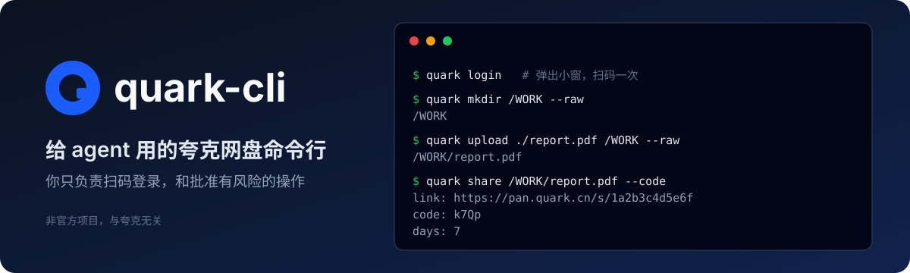

<p align="center">
  
</p>

# quark-cli

[](https://github.com/jinhuang712/quark-cli/actions/workflows/ci.yml)
[](https://github.com/jinhuang712/quark-cli/releases)
[](LICENSE)
[](https://nodejs.org)
[](INSTALL.md)

夸克网盘的命令行，**主要给 agent 用**：agent 在终端里浏览、整理、上传下载和分享你的网盘文件，你只负责扫码登录和批准有风险的操作。

夸克没有公开的命令行工具，`quark` 通过夸克网盘网页版的接口工作：用你自己登录的本机 Chrome 发请求，不经过任何第三方服务器。

> [!WARNING]
> **非官方项目，请先看这几条**
>
> - 本项目与夸克、阿里巴巴**没有任何关系**，不隶属于它们，也未获得它们的认可。
> - 它用的是夸克网页版的**私有接口**，没有文档，夸克随时可能改，改了就要跟着改。
> - 有**账号风险**：批量操作可能触发夸克的风控（限制功能、甚至封号）。这个工具不绕过夸克的限速、风控或封禁，批量上传最多同时传 3 个文件。使用前请先看夸克的用户协议，后果自负。
> - 登录态保存在本机 `~/.quark-cli/profile`，等于你的账号密码，不会上传到任何地方。详见 [SECURITY.md](SECURITY.md)。

## 能做什么

- **账号**：`login`（只有二维码的小窗，用夸克 APP 扫码）、`whoami`、`logout`。
- **浏览**：`ls`、`search`、`info`。
- **整理**：`mkdir`、`mv`、`rename`、`rm`（进回收站，不加 `--yes` 不会删）。
- **传输**：`upload`（文件和文件夹，3 个文件并行）、`download`（单个文件）。
- **分享**：`share`、`shares`、`unshare`、`save`。

几条贯穿所有命令的约定：

- **每个命令只做一件事。** 不自动建目录，不自动跳过、覆盖或合并同名项，不弹出提问；需要几步就用几条命令，用 `--raw` 串起来。
- **输出默认是 YAML**，字段精简；另有 `--json`、`--markdown`、`--raw`，`--full` 输出全部字段。
- **失败时 stderr 有 `error`、`code`、`exit`、`next`**，`next` 告诉调用方下一步做什么；退出码固定：0 成功，1 其他错误，2 用法不对，3 需要登录，4 找不到，5 夸克拒绝。
- **`quark --help`** 和 **`quark <命令> --help`** 讲清楚怎么用，包括会不会改动网盘、能不能撤销。

每个功能的行为、默认值和失败情况都写在 [FEATURES.md](FEATURES.md)。

## 安装

需要 Node 20 以上，和本机的 Google Chrome。

```bash
curl -fsSL https://raw.githubusercontent.com/jinhuang712/quark-cli/main/install.sh | bash
```

装好后直接敲 `quark`，同时会装好 Claude Code skill。不用 sudo，不改 shell 配置。参数、升级、卸载、手动安装见 [INSTALL.md](INSTALL.md)。

## 第一次用

```bash
quark login          # 弹出小窗，用夸克 APP 扫码
quark whoami
quark ls /
quark search 简历
quark upload ./report.pdf /WORK      # /WORK 要先存在，没有就先 quark mkdir /WORK
quark share /WORK/report.pdf
```

登录态保存在 `~/.quark-cli/profile`，设置环境变量 `QUARK_PROFILE` 可以换位置。登录态等于账号密码，不要提交到 git，也不要拷给别人。

## 已知限制

- 只能用 Google Chrome，不支持 Edge 和 Firefox。Chrome 装在非标准位置时，设置环境变量 `QUARK_CHROME_PATH` 指向它的可执行文件。
- 只读命令（`ls`、`search`、`info`、`whoami`、`shares`）直接带着登录时存下的 cookie 调接口，不启动 Chrome，每条约 0.4 秒，可以并行（不要超过 3 条）；会改动网盘的命令仍然启动一次 Chrome，每条约 1.5 秒。`--help` 约 0.15 秒。
- 会改动网盘的命令要等到结果能被读到才返回，所以紧接着的 `ls`、`mv`、`share` 不会读到旧数据。
- `download` 只能下载单个文件，夸克网页版不让下载 60MB 以上的文件（实测 50MB 能下）；没有断点续传，`upload` 也没有。
- `upload` 直接调夸克的上传接口，出意外会退回网页上传，退回后每个小文件约 5 秒。
- `save`（转存别人的分享）还没有成功转存过的测试。
- 只在 macOS 上测过。

还没解决的事见 [TODO.md](TODO.md)。

## 文档

- [INSTALL.md](INSTALL.md)：安装、升级、卸载
- [FEATURES.md](FEATURES.md)：每个功能做什么、做不到什么、不会做什么
- [CLI.md](CLI.md)：每条命令的写法、参数、输出字段和错误码的查阅表
- [skills/quark-cli/SKILL.md](skills/quark-cli/SKILL.md)：教 agent 使用 `quark` 的 skill
- [CONTRIBUTING.md](CONTRIBUTING.md)：开发、测试
- [SECURITY.md](SECURITY.md)：能碰什么、怎么报告安全问题
- [TODO.md](TODO.md)：还没验证的和还没解决的
- [CHANGELOG.md](CHANGELOG.md)

## 许可

MIT
